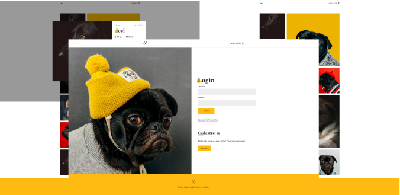
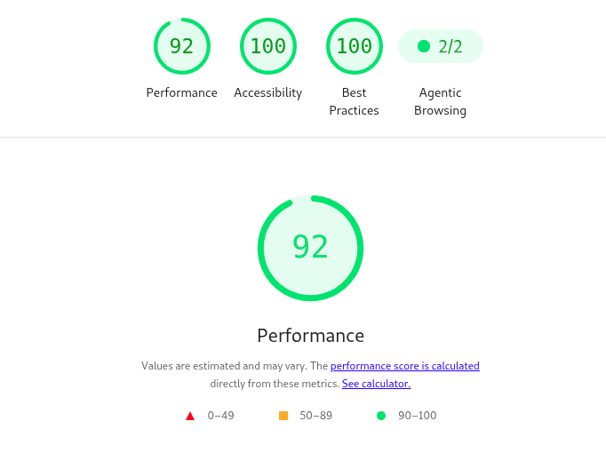
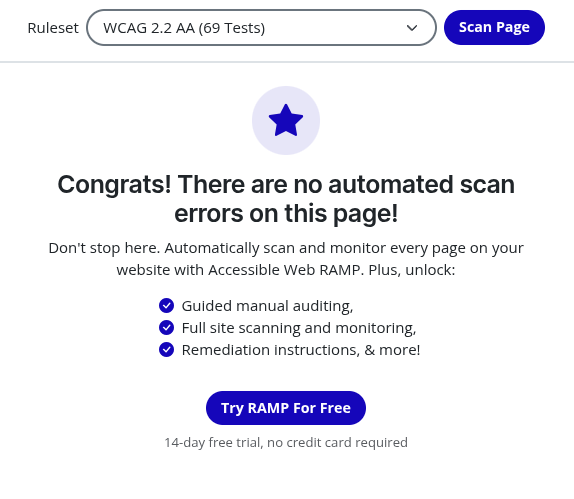

# 🌍 Rede Social para Cachorros

O Dogs Social Media é um projeto desenvolvido como parte de um estudo de React.

O objetivo foi criar um "clone" simplificado do Instagram.

## Demo

Acesse: https://dogs-social-media-kappa.vercel.app/

## 💻 Tecnologias Utilizadas

* HTML5

* CSS3

* React

* Design responsivo

## ⚡ Performance e Acessibilidade

O projeto foi otimizado para alcançar excelentes métricas de desempenho e acessibilidade utilizando boas práticas de design e desenvolvimento web.

### Lighthouse

### Accessible Web

## 👩‍💻 Sobre a Designer

Desenvolvido por mim — UI/UX Designer & Front-end Developer.
Apaixonada por criar experiências digitais que unem estética, propósito e funcionalidade.

**📫 Entre em contato:**

[LinkedIn](https://www.linkedin.com/in/la%C3%ADs-reis/) | [Behance](https://www.behance.net/laisreis2)